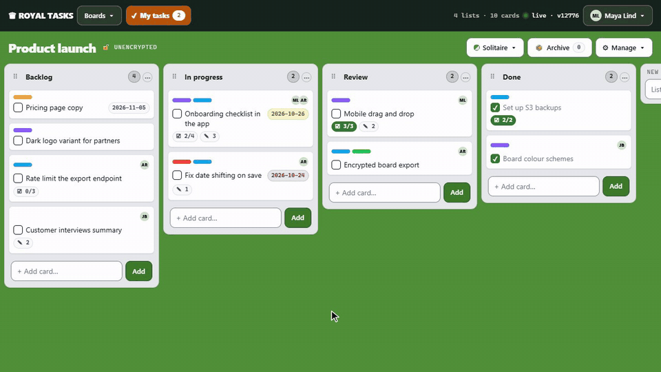
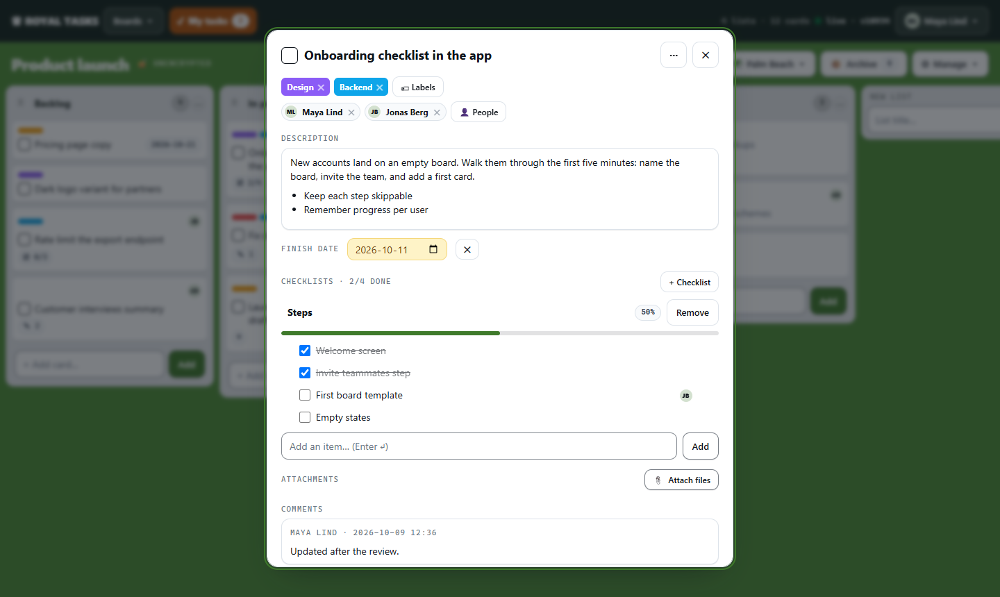
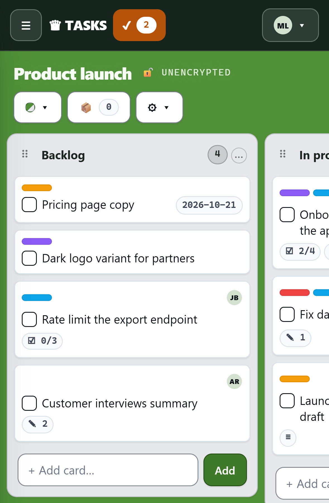

# ♛ Royal Tasks

**A modern, pleasant and responsive Kanban tool that runs on normal web hosting.** Royal Tasks gives a team the ease of tools like Trello, Asana, Jira or Microsoft Planner on a server of its own: drag-and-drop boards with checklists, labels, people and comments, changes that reach every member within seconds, and a design that feels as good on a phone as on a desktop. Every board is encrypted in the database, and any board can also be **encrypted end to end**, so that not even the server can read it.

Royal Tasks is designed for individuals, groups, or small organizations.

## Why Royal Tasks

-   **Pleasant to use.** Cards and lists behave like things you pick up and put down; every change shows at once, without waiting for the server; it works by touch and installs on a phone like an app.
-   **Runs on ordinary web hosting.** PHP and a MySQL or MariaDB database are all it needs: no Node server, no Docker, no build step on the server, no background workers. Upload one folder, open the installer, done.
-   **Your data stays yours.** No third-party scripts or CDNs, no tracking, encryption at rest by default, and optional end-to-end encryption per board with a recovery key.
-   **Open.** Apache-2.0, with every bundled library credited.

    [](LICENSE)



## Features

**Boards that stay out of your way**

-   Lists and cards with drag and drop, on desktop and by touch. Long lists scroll while you drag, and every move shows at once, without waiting for the server.
-   Cards with rich descriptions, finish dates coloured by urgency, checklists with progress, comments, attachments and title images. A card titled with a web address links to it and picks up the page's picture; a checklist item that is one shows the page's title with the site's icon.
-   Up to 10 labels per board, toggled with the keys 1–9 and 0 on an open card.
-   Assign cards and checklist items to people. **My tasks**, at the top, lists what is yours on every board: first what has no finish date, then what has one, soonest first; last, the other deadlines on your boards.
-   A red bar tells you at once when the server cannot be reached, and when it is back.
-   A calendar subscription (Preferences): your deadlines, or all of them, from the boards you choose, in Google Calendar, Outlook or Apple Calendar.
-   Find on a board (Ctrl+F), an archive per board, Shift+Delete to delete a card, eight colour schemes, Dark and Synthwave among them.
-   Built-in viewers for PDF, Word, HEIC photos, images, video, audio and text, so attachments open without leaving the card.

**Made for teams**

-   Share a board by username as **viewer** or **editor**. Changes reach the other members within seconds, and simultaneous edits never overwrite each other.
-   Profiles with a name, email address and picture.
-   Invite people by email; they make their own account. "Forgot your password?" sends a link to sign in and choose a new one. Email goes out through whatever the server has: SMTP, PHP's mail() or sendmail.
-   An administrator creates the accounts. There is no public sign-up.

**Private by design**

-   Every board is encrypted in the database, and every file on disk.
-   Give a board a password and it is **encrypted end to end**: the browser encrypts it before sending, and the server never sees the content. A recovery key covers a lost password.
-   The administrator has no access to boards they are not a member of.
-   A strict Content Security Policy, and no third-party scripts: every library is served from your own server.

**Works where you are**

-   Responsive from phone to desktop, and installable as an app on Android, iPhone, iPad and computers, straight from the browser with no app store ([how](docs/install.md#installing-it-as-an-app-phones-tablets-computers)).
-   Share a link, text or photo from your phone straight into a card, on the board and list you choose.
-   Move boards in and out: import and export in Trello's JSON format, with labels, checklists and comments.
-   Automatic backups to S3-compatible storage, with one backup a month kept for good.

<table>
  <tr>
    <td width="66%"></td>
    <td width="34%"></td>
  </tr>
</table>

## Quick start

You need PHP 8.4+ and a MySQL or MariaDB database. Shared hosting is fine.

1.  Copy the app into the folder it should be served from, e.g. `public_html/kanban/` ([which files](docs/install.md#what-to-copy-to-the-server)).
2.  Open `https://yoursite/kanban/install.php` and enter the database details. The installer creates the tables, the master account and `config.php`.
3.  Sign in with the password it shows once, choose your own, and delete `install.php`.
4.  Open Preferences → Administration once and save, so emailed links point to your site; then create accounts or invite people by email.

To update later, copy in the new files and run `php upgrade.php` (or open it as an administrator); see [Updating](docs/install.md#updating-an-installation).

**Back up `config.php` with the database:** it holds the key that the stored boards are encrypted with.

To try it locally:

```bash
php -S 127.0.0.1:8080 -t . router.php
```

then open [http://127.0.0.1:8080/install.php](http://127.0.0.1:8080/install.php).

## Documentation

|  |  |
| --- | --- |
| [Installing and running](docs/install.md) | Requirements, install, updates, email, installing it as an app on phones and computers, S3 backups, nginx and Apache |
| [Security and privacy](docs/security.md) | Who can see what, encryption at rest and end to end, and how the app is protected |
| [Reporting a vulnerability](SECURITY.md) | How to report a security problem privately |
| [Developing](docs/development.md) | Layout of the code, database, styling, and the test suites |
| [Agents.md](Agents.md) | The design reference: every feature, and the rules the code keeps |
| [Credits](CREDITS.md) | The open-source libraries Royal Tasks is built on |

## Built with

PHP 8.4 and MySQL/MariaDB on the server; plain ES6 classes in the browser, with no framework and no build step beyond Tailwind CSS. Encryption uses [libsodium](https://libsodium.org); attachments are shown with [PDF.js](https://mozilla.github.io/pdf.js/), [mammoth](https://github.com/mwilliamson/mammoth.js) and [libheif](https://github.com/strukturag/libheif). See [CREDITS.md](CREDITS.md) for every library and its licence.

## Credits and license

Developed by **Jesper Juul**.

© 2026 Jesper Juul. Royal Tasks is released under the [Apache License, Version 2.0](LICENSE). The libraries it ships keep their own licences; see [CREDITS.md](CREDITS.md).
